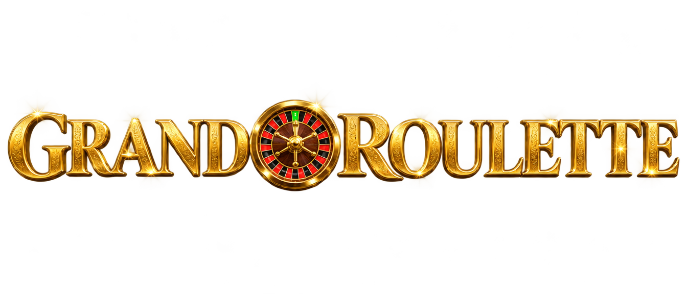
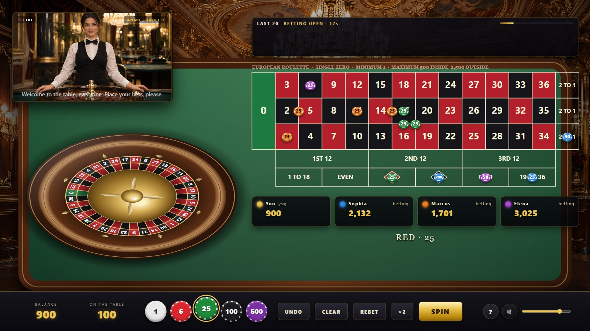
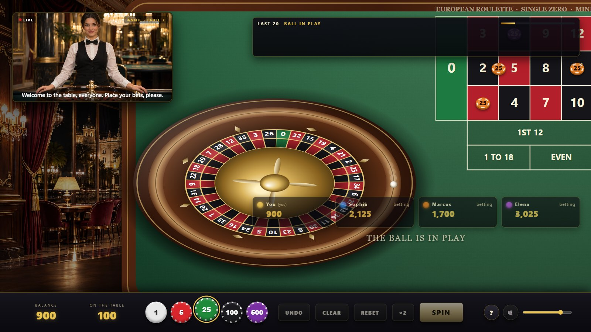
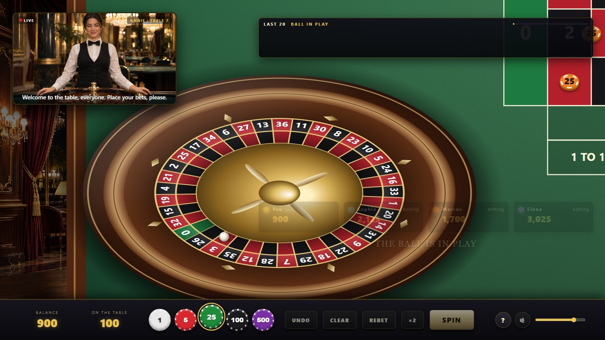
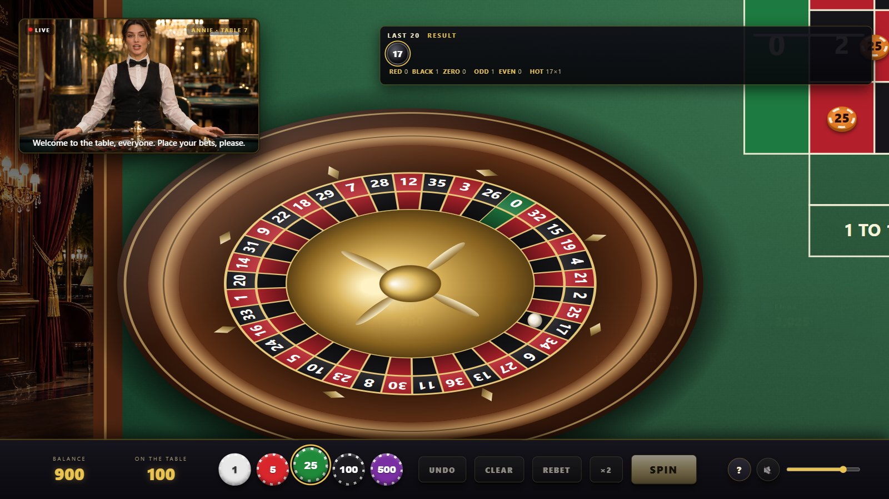
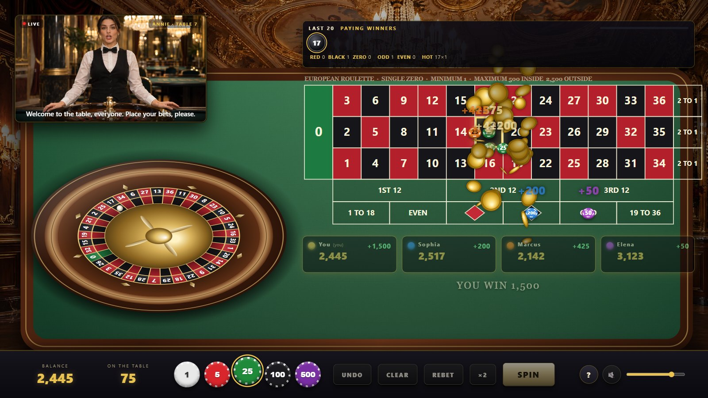
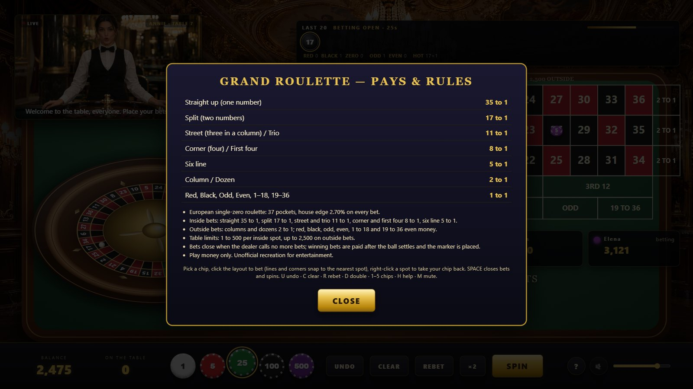

<div align="center">



### A grand European roulette table with a physically simulated wheel, a talking live dealer, three regulars and a last-20 board


</div>

Plain HTML5 Canvas, Web Audio and vanilla JavaScript. No frameworks, no build
step. The ball is simulated on the track, down the cone past the deflectors
and across the frets; the dealer is a generated human croupier who speaks
every call (lip-synced video for the table phrases, generated voice for all 37
numbers); three AI regulars bet with you; every bet spot of the European
layout is covered and verified to pay 36/37.

> Unofficial recreation for entertainment only. Play money, no real wagering.

---

## Contents

1. [Features](#features)
2. [Platforms](#platforms)
3. [Installation](#installation)
4. [Configuration reference](#configuration-reference)
5. [User guide](#user-guide)
6. [Keyboard shortcuts](#keyboard-shortcuts)
7. [Known limitations](#known-limitations)
8. [Project layout](#project-layout)
9. [Development](#development)

---

## Features

**The wheel**

* European single-zero wheel in the real pocket order, rendered in perspective:
  mahogany bowl, ball track, cone with eight deflectors, rotor with number ring,
  pockets and frets, brass cone and turret
* The rotor spins counter-clockwise and slowly loses speed; the ball is launched
  clockwise and decays with friction, leaves the track below a threshold, slides
  down the cone, may strike a deflector (bounce and angular kick), then hops across
  the frets with decaying bounces and settles. The winning number is drawn first;
  the hop phase is steered so the ball ends in that pocket
* Motion-blurred ball with shadow, a camera that pushes in for the drop and
  pulls back for the payout

**The dealer**

* Generated photoreal croupier in a live-stream style panel with a LIVE badge
* Two lip-synced talking-head videos carry the twelve table phrases (welcome,
  place your bets, last bets, no more bets, winners, no winners, you win, call-outs
  by name, spinning, thank you); 37 generated voice lines call every number with
  its colour; captions under the video
* A queue keeps lines from overlapping; speech segments are found automatically
  by silence detection on the video's audio track

**The table**

* 157 bet spots: straight, split, street, trio, corner, first four, six line,
  column, dozen, red/black, odd/even, low/high; clicks snap to the nearest spot
* Limits 1–500 inside and 2,500 outside; chips of 1, 5, 25, 100, 500; undo,
  clear, rebet, double; right-click takes a chip back
* Losing chips are swept to the dealer, winning chips are paid from the dealer
  with floating amounts; the marker (dolly) sits on the winning number
* Three regulars with bankrolls and styles (outside player, number chaser,
  mixed), who place chips during the window and rebuy when broke
* History board: the last 20 numbers as coloured tokens plus red/black/zero,
  odd/even and hot-number counts, and the betting countdown

**Sound (synthesized in Web Audio, plus the generated voice)**

* Salon murmur bed, ball roll that follows speed and surface, deflector clicks,
  fret hops, the settle rattle, chips placed, stacked, swept and paid, the
  no-more-bets chime, the marker tap, win chimes and fanfares

---

## Platforms

| Platform | Status | Notes |
| --- | --- | --- |
| Chrome / Edge (desktop) | Tested | Headless Chrome runs the smoke test and screenshots |
| Firefox (desktop) | Expected to work | Canvas 2D, Web Audio, MP4/AAC video |
| Safari (macOS / iOS) | Expected to work | Audio and video start after the first tap |
| Offline / `file://` | Partially | Table, wheel and synthesized sound work; voice clips and dealer video need HTTP |

Serve the folder over HTTP for the full experience. Node.js 22+ is only needed
for the tools.

---

## Installation

1. **Get the files.** Keep `assets/`, `css/` and `js/` next to `index.html`.
2. **Serve it:**

   ```bash
   python -m http.server 8771
   ```

   or double-click `start.cmd` on Windows, then open <http://localhost:8771/>.
3. **Click once** on the splash to take a seat (this unlocks audio and video).
4. Optional URL parameters: `?mute=1` starts silent, `?fast=1` shortens the
   betting window and result hold, `?force=17` makes every spin land on 17.

### Configuration reference

| Setting | File | Default | Meaning |
| --- | --- | --- | --- |
| `PAYOUT` | `js/config.js` | 35 / 17 / 11 / 8 / 5 / 2 / 1 | Profit per unit for each bet type |
| `LIMITS` | `js/config.js` | `inside 500, outside 2500, min 1` | Table limits per spot |
| `CHIPS` | `js/config.js` | 1, 5, 25, 100, 500 | Chip values and colours |
| `PLAYERS` | `js/config.js` | You + Sophia, Marcus, Elena | Names, colours, bankrolls, styles |
| `TIMING` | `js/config.js` | `bettingMax 26, lastBetsAt 7, resultHold 6.5` | Round pacing in seconds |
| `history` | `js/config.js` | `20` | Numbers kept on the board |
| `TABLE` | `js/config.js` | `76 × 84` cells | Layout geometry in the 1920 × 1080 frame |
| `WHEEL` | `js/renderer.js` | `R 300, sy 0.6` | Wheel size and perspective |
| ball launch / friction | `js/wheel.js` | `10.5–13 rad/s, tau 4.3–4.9 s, drop below 3.0–3.4 rad/s` | Spin feel and length |
| `LINES`, `VIDEOS` | `js/dealer.js` | 15 phrases + 37 numbers | What the dealer says and which video carries which phrase |
| `roulette.volume`, `roulette.muted` | browser `localStorage` | `0.8`, `0` | Remembered volume and mute |

---

## User guide

### Taking a seat



The dealer welcomes the table and opens betting. Pick a chip in the tray, click
the layout to place it: number cells take straight-up bets, lines and corners
snap to splits, streets, corners, six lines and the zero bets; the outside boxes
take columns, dozens and the even-money bets. Hovered spots light the numbers
they cover. The regulars place their chips over the first seconds; the board
shows the countdown. Press **SPIN** (or wait) to close the bets.

### The spin



"No more bets" locks the layout. The ball runs the track for about six seconds,
then the camera pushes in as it drops, strikes the deflectors and hops over the
frets before settling.



### Result and payout



The dealer calls the number and colour, the winning cell glows and the marker
is placed. Losing chips are swept to the dealer, winners are paid with floating
amounts, the seats of the winners light up and the dealer congratulates them by
name. The board adds the number to the last twenty.



### Help



---

## Keyboard shortcuts

| Key | Action |
| --- | --- |
| `Space` / `Enter` | Close bets and spin |
| `1` – `5` | Select chip 1 / 5 / 25 / 100 / 500 |
| `U` | Undo last bet |
| `C` | Clear your bets |
| `R` | Rebet last round |
| `D` | Double your bets |
| `H` | Help |
| `M` | Mute / unmute |
| right-click | Take your chip back from a spot |

---

## Known limitations

* The ball's path is physically motivated but outcome-first: the number is drawn
  by the cryptographic RNG before the spin and the final hops are steered to it,
  which is how video roulette works; the landing is always on that pocket.
* The dealer's lip-synced video covers the twelve table phrases; number calls
  play as voice over a talking loop, so the mouth does not match those exactly.
* Voice and video are fetched over HTTP; from `file://` the dealer still speaks
  through captions and synthesized cues only.
* Single-zero European rules only; no La Partage / En Prison, no racetrack
  (neighbour) bets, no American double zero.
* Play money; balances are not saved between visits.

---

## Project layout

```
roulette/
├── index.html            canvas scene + dealer panel, board, seats, chip bar, help, splash
├── start.cmd             Windows launcher (local server + browser)
├── css/style.css         HUD styling
├── js/
│   ├── config.js         wheel order, payouts, limits, table geometry, chips, players, timing
│   ├── table.js          all 157 bet spots, hit testing, settlement
│   ├── audio.js          shared Web Audio synthesizer engine
│   ├── audio-roulette.js ambience, ball, chips, chimes, voice clip playback
│   ├── fx.js             sparkles, coins, flash (shared engine)
│   ├── wheel.js          rotor and ball physics with steered landing
│   ├── dealer.js         live-dealer panel: video segments, voice queue, captions
│   ├── players.js        the three regulars and their betting styles
│   ├── renderer.js       salon, table, layout, chips, marker, wheel, camera, flyers
│   ├── game.js           round flow, bets, payouts, call-outs, history
│   ├── ui.js             DOM: board, seats, tray, buttons, pointer handling, keyboard
│   └── main.js           bootstrap, frame loop, test hooks
├── assets/
│   ├── bg/salon.jpg      casino salon backdrop
│   ├── logo.png          title logo
│   ├── dealer/           dealer.png portrait, talk1.mp4 / talk2.mp4 lip-synced clips
│   └── audio/            52 generated voice lines (n0–n36 and the table phrases)
├── docs/                 landing page + screenshots
└── tools/
    ├── edge-check.js     proves every bet spot returns 36/37 (+ Monte Carlo)
    ├── screenshots.mjs   headless smoke test (full round, payouts asserted) + screenshots
    └── pngalpha.py       alpha report for PNG assets
```

---

## Development

**Run locally:** `python -m http.server 8771` and open <http://localhost:8771/>.

**Test hooks:** `?force=<0–36>` fixes the winning number, `?fast=1` shortens
rounds, `?mute=1` silences audio. In the console, `RL.step(seconds)` advances the
simulation deterministically, `RL.game` is the round state machine,
`RL.game.placeBet('you', 'straight:17', 25)` places a bet, `RL.dealer.say('n17')`
makes the dealer speak.

**Check the maths:** `node tools/edge-check.js` enumerates every spot (expected
return 97.30 %, house edge 2.70 %) and runs a Monte Carlo over mixed bets.

**Smoke test and screenshots:** `node tools/screenshots.mjs` drives a whole round
in headless Chrome (four human bets, bots, close, spin, forced 17, payout of
2,475, next round) and fails on any console error or wrong balance.

**Publish:** enable GitHub Pages for the repository root; the table is served at
`/` and the landing page at `/docs/`.
